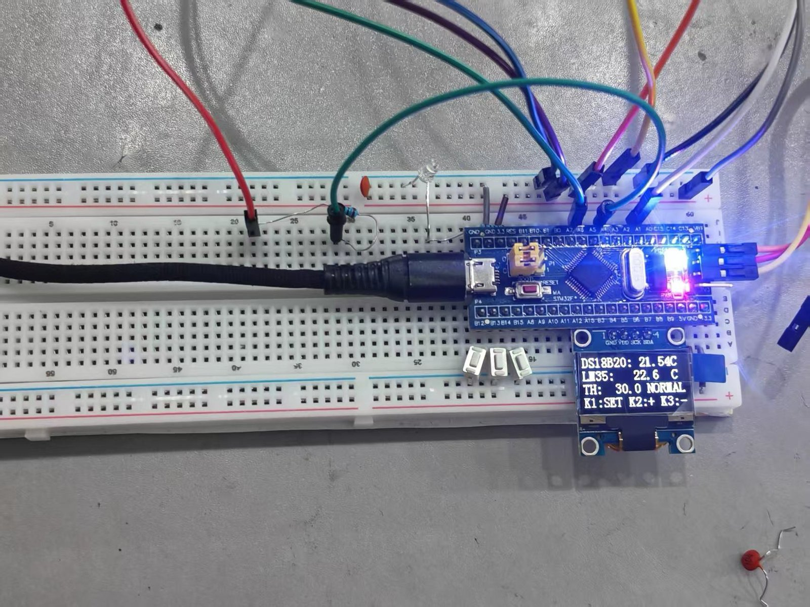

# 基于 STM32 的环境温度测量仪

> STM32F103C8T6 + DS18B20 + LM35 双通道测温：OLED 显示、阈值报警、按键设置、串口数据输出。整机以面包板搭建（免焊接）。



*上电实测：DS18B20 21.54 ℃ / LM35 22.6 ℃（同一房间并排），TH 30.0 NORMAL*

## 功能特性

- **双测温通道**：DS18B20（1-Wire，12 位，0.0625 ℃）与 LM35（模拟，10 mV/℃）同时采集，可做一致性对照
- **OLED 显示**：SSD1306（I²C，128×64），四行显示两路温度、阈值与状态
- **阈值报警**：单阈值 + 0.5 ℃ 回差，3 针蜂鸣器模块 + 报警 LED
- **按键设置**：3 键（SET / ＋ / －），阈值 0.0～99.0 ℃、步进 0.5 ℃
- **串口输出**：板载 CH340，115200，约 1 Hz 输出 CSV 行
- **心跳指示**：PC13 板载 LED 约 1 Hz 翻转

## 硬件连接

| 器件 | 型号 / 规格 | 连接 |
|---|---|---|
| 主控 | STM32F103C8T6 最小系统板（Blue Pill） | USB 供电 + 板载 CH340 |
| 数字温度 | DS18B20 模块 | DQ → PA1（模块自带 4.7 k 上拉） |
| 模拟温度 | LM35DZ（TO-92） | 1→5V、3→GND、2→R9 100 Ω→PA4 |
| 显示 | SSD1306 OLED 0.96″（I²C 0x3C） | SCL→PB6、SDA→PB7 |
| 蜂鸣器 | 3 针模块（VCC/GND/IO） | IO → PA6（TIM3 PWM，2 kHz） |
| 报警灯 | 红色 LED + 1 kΩ | PA7 |
| 按键 | 轻触开关 ×3 | PB12 / PB13 / PB14 → GND |
| 下载调试 | ST-Link V2 | SWDIO / SWCLK / GND（不接 3.3 V） |

> 完整接线见 [docs/实验方案（实施版）.md](docs/实验方案（实施版）.md)，示意图见 `面包板接线图.png`。

## 快速开始

1. 安装 Keil MDK5（含 STM32F1xx 器件支持包）与 ST-Link 驱动；
2. 打开 `Project.uvprojx`，编译（标准外设库 V3.5.0 已随工程提供）；
3. ST-Link 接 SWDIO / SWCLK / GND，下载程序；
4. 插 USB 供电（同时提供 5 V 与 CH340 串口），串口助手 115200 查看数据。

## 使用说明

| 按键 | 功能 |
|---|---|
| K1 | 进入 / 退出阈值设置 |
| K2 / K3 | 阈值 + / − 0.5 ℃ |

上电自检后进入主界面；温度超过阈值触发报警（蜂鸣 + LED），低于「阈值 − 0.5 ℃」后解除。

串口输出示例：`序号,DS=22.33C,LM=22.3C,TH=30.0C,NORMAL`（报警时末段为 `ALARM`）。

## 已知限制

- **0 ℃ 以下不可测**：LM35 单电源直采，负温输出无法进入 ADC（固件对负值按 0 处理）；
- **阈值不保存**：未安装 AT24C02，断电后恢复默认 30.0 ℃；
- **单只 DS18B20**：驱动使用 `0xCC` 跳过 ROM，不支持同总线多探头；
- **面包板搭建**：接触可靠性有限，移动后建议先确认读数；
- 运放调理与 C3 抗混叠电容未装（可选，设计见方案文档「备选方案」）。

## 工程结构

```text
├─ Start/       CMSIS 与启动文件
├─ Library/     ST 标准外设库 V3.5.0
├─ System/      Delay 延时驱动
├─ Hardware/    OLED / DS18B20 / Key / Alarm / Uart 驱动
├─ User/        main.c（主循环）
├─ docs/        方案与实施文档
├─ 面包板接线图.png / .svg      整机接线
├─ 面包板版面图.png / .svg      面包板布局
├─ B板模拟接线图.png / .svg     备选方案（运放调理，未采用）
├─ 电阻接法示意.png / .svg      面包板电阻/支路示意
└─ _gen_*.py    绘图脚本（可重新生成示意图）
```

## 自研 / 复用说明

- **自研**：主循环与业务逻辑（采样、滤波、显示、按键、报警、串口）、整机接线与面包板实现、示意图与调试记录、方案文档；
- **复用 / 参考**：底层驱动基于**江协科技《STM32 入门教程》**配套标准库例程改写（OLED 软件 I²C、DS18B20 单总线、定时器 PWM 等），版权归原作者；ST 标准外设库 V3.5.0 版权归 STMicroelectronics；
- 本项目供学习参考，请勿直接用作课程作业提交。

## 许可

- 本项目自研部分采用 [MIT License](LICENSE)；
- 第三方组件（ST 标准外设库、教程例程改写）保留原有版权与许可。
